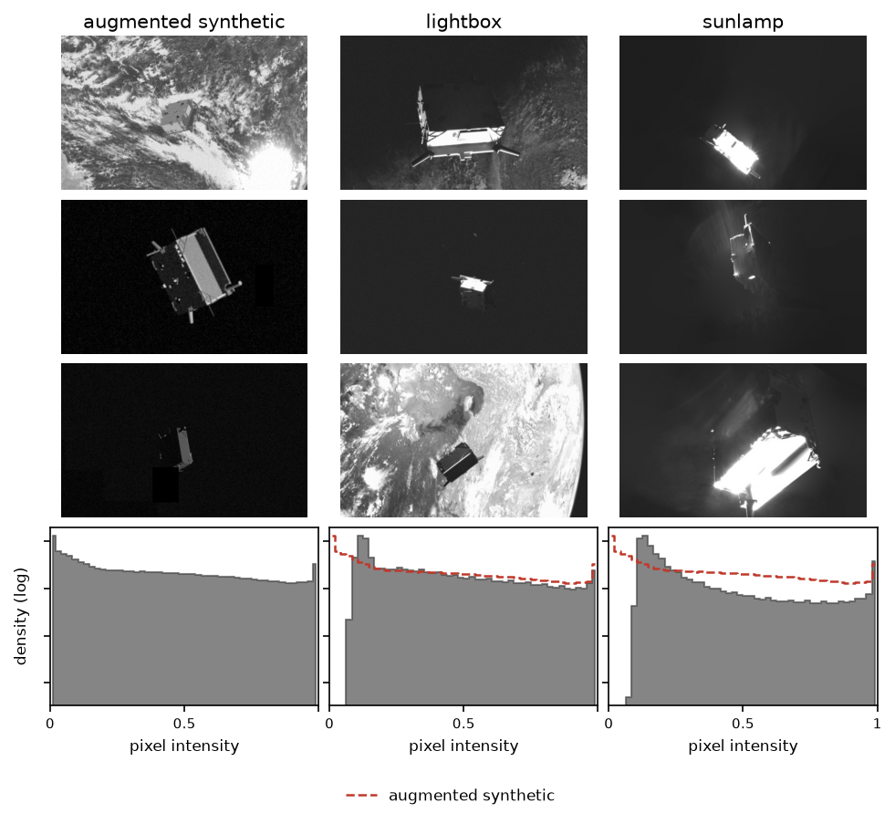

# Unreasonable Confidence from Simulator Misspecification

**Directional robustness on the SPEED+ sim-to-real benchmark.**

A photometric augmentation stack is a guess at *how a simulator is wrong*. This
is a study of what happens when the guess is wrong: robustness arrives only in
the direction you augmented, and the model's confidence gives no warning.

**Paper.** Nikolay Dolgov. *Unreasonable Confidence from Simulator
Misspecification: Directional Robustness on the SPEED+ Sim-to-Real Benchmark.*
Sim2Science: ML with Imperfect Scientific Models, workshop at NeurIPS 2026.

<!-- TODO before release: add badges once arXiv and HuggingFace are live.
     [](https://arxiv.org/abs/XXXX.XXXXX)
     [](https://huggingface.co/TODO)
     [](https://paperswithcode.com/dataset/speed) -->

---

## An imperfect scientific model

A spacecraft sent to service, inspect, or de-orbit another satellite has to
estimate the pose of its target, position and orientation in six degrees of
freedom, from its own cameras, in real time, under a fuel budget.

The target is *uncooperative*: no markers, no transponder, no help. There are
also essentially no labelled photographs of it in orbit, since taking them would
require having already solved the problem. The estimator is therefore trained on
the output of a simulator and deployed against the physical system that
simulator only approximates.

That simulator is not a physics engine. SPEED+'s synthetic images come from an
OpenGL rasteriser, the Optical Stimulator camera emulator, whose shading is an
empirical model of how sunlit foil and metal look, chosen for speed over
fidelity. That shading model is a closure in the same sense as an empirical
force field in molecular dynamics or a sub-grid parametrisation in a climate
model: a cheap stand-in for physics the simulator never resolves, and the place
its error lives.

The resulting error is radiometric rather than geometric. Ranges and pose
distributions are matched across the benchmark's domains. What differs is that
mylar and machined metal return specular, non-Lambertian reflections, which a
collimated source turns into hard shadow boundaries and saturated pixels. And
saturation is not a reflectance error at all: it is a misspecified *observation
operator*, arising in the detector rather than in light transport.

## What the misspecification costs

Enough to matter. In SPEC2021, the competition run on this benchmark, the
winning entry's pose score degraded roughly **40×** between synthetic validation
and real hardware-in-the-loop imagery.

[SPEED+](https://zenodo.org/records/5588480) exists to study exactly this. It
pairs ~60,000 labelled synthetic images of the Tango spacecraft with ~9,500 real
images of a physical mockup under two illumination regimes:

- **lightbox**, diffuse and Earth-albedo-like
- **sunlamp**, a collimated solar simulator: harsh, directional, specular

This study asks a narrower question than "how well can we do". It asks what
actually transfers: not how much a gain helps in simulation, but which gains
survive the crossing, and whether the model's own confidence survives with them.

## The discrepancy model

The standard response to a misspecified simulator is not to fix the forward
model but to smear the training data over the ways it might be wrong. A
photometric augmentation stack, made of brightness and contrast jitter,
log-uniform gamma, a soft clamped "sun glare" blob, blur, noise and random
erasing, is therefore a **discrepancy model**: an unvalidated guess at the
simulator-to-reality residual, imposed as a distribution the training data is
smeared over rather than as a correction to the forward model.

It is unvalidated in a way that is hard to escape, since measuring the residual
it claims to model would take the real labelled images whose absence created the
problem in the first place.

So the guess goes in untested, and this repository is about what happens when it
is wrong. The answer is not only a loss of accuracy but a silent loss of
calibration, which is finding 3 below.

## Approach

Deliberately simple, so that the transfer *structure* stays visible rather than
buried in a competitive pipeline. An ImageNet-pretrained ResNet-50 feeds pooled
2048-d features to a two-layer head that regresses translation and a unit
quaternion: direct pose regression, trained only on synthetic images.

A 2×2 design over the two levers that were actually available:

|                    | no augmentation | photometric augmentation |
|--------------------|-----------------|--------------------------|
| **frozen backbone**| arm 1           | arm 2                    |
| **layer 4 trainable** | arm 3 (×3 seeds) | arm 4 (×3 seeds)     |

Everything else is held fixed: 28k training images at 320×512 grayscale, Adam at
1e-3, batch 16, 20 epochs. Checkpoints are selected on synthetic validation
rotation error alone; the real domains are touched once, at evaluation, and
never inform training, tuning, or selection.

The loss splits translation from rotation:

```
L = MSE(t̂, t) + λ · (1 − ⟨q̂, q⟩²)
```

The squared inner product is sign-invariant, and labels are canonicalised to one
hemisphere, so the quaternion double cover (q and −q are the same rotation)
cannot hand the network contradictory targets.

**Reading rotation errors.** A uniformly random orientation guess scores
π/2 + 2/π ≈ 2.207 rad. Raw errors crowded against that ceiling understate gaps
badly: 1.67 and 2.07 rad look close, but as *skill above chance* they are 0.54
and 0.13, which is meaningfully better than guessing against barely better.
Both are reported.

SPEED+ orientations are not uniform on SO(3), so the chance level is also checked
against an achievable no-skill predictor: a single constant pose fitted on the
28k training labels alone, never on a test domain.

```bash
python scripts/constant_baseline.py    # labels only — no images, no checkpoint, no GPU
```

It scores E_R 2.177 on synthetic validation and 2.203 / 2.199 on lightbox and
sunlamp, all within 0.03 rad of the uniform value, which is why 2.207 is used
throughout. (App. C of the paper refines this chordal mean with five Karcher
iterations and quotes 2.176 for synthetic; the two agree to 0.001 on every
score. The refinement is not implemented in this script.) Translation is the uncomfortable half: that constant scores E_T
0.372 on sunlamp, and two of the three augmented seeds do not beat it.

## Headline result

E_T is range-normalised, E_R is in radians. Mean ± s.d. over seeds {42, 43, 44};
frozen arms are single-seed (†). Head-only retrains of the frozen arm on cached
features put its seed s.d. at 0.017 / 0.026 / 0.031 rad (synthetic / lightbox /
sunlamp); see [Revision experiments](#revision-experiments).

| Backbone | Aug. | Synthetic E_T | Synthetic E_R | Lightbox E_T | Lightbox E_R | Sunlamp E_T | Sunlamp E_R |
|---|---|---|---|---|---|---|---|
| frozen† | — | 0.066 | 1.053 | 0.151 | 1.752 | 0.253 | 2.048 |
| frozen† | ✓ | 0.071 | 1.180 | 0.118 | 1.718 | 0.306 | 1.864 |
| layer 4 | — | 0.036±0.002 | 0.317±0.010 | 0.169±0.027 | 1.166±0.018 | 0.311±0.036 | 1.534±0.075 |
| layer 4 | ✓ | 0.042±0.002 | 0.322±0.027 | 0.150±0.017 | **0.987±0.010** | 0.355±0.081 | 1.468±0.119 |

Regenerate this table from the trained checkpoints (not published yet — see
[Reproduce the table](#4-reproduce-the-table)):

```bash
python scripts/reproduce_table.py --from-checkpoints <checkpoint-dir>
```

## What worked, and what didn't

### 1. Transfer is asymmetric: the *source* of a gain predicts whether it crosses

Scaling from 4k to 28k images and moving the head from ImageNet logits to pooled
features improved synthetic rotation error by 0.61 rad (1.67 → 1.05), both
scored on the same 2,000-image synthetic validation split used throughout. It
moved sunlamp by 0.03 rad (2.07 → 2.05), less than the frozen head's seed s.d.
there (0.031), so not detectably at all. Lightbox absorbed about 40% of it.

Unfreezing layer 4 behaves quite differently: synthetic goes 1.05 → 0.32, and
the real domains follow, sunlamp 2.05 → 1.53 and lightbox 1.75 → 1.17, which is
roughly 70–80% of the marginal synthetic gain carried across.

Feeding a frozen ImageNet representation more data did not transfer. Adapting
the representation did.

Three pre-registered checks support this. Over three seeds, the four
{4k, 28k} × {logits, pooled} cells split the synthetic gain roughly evenly
between data (0.33 rad) and features (0.29 rad), and neither moves sunlamp
beyond seed variation. Tuning the head's learning rate and epochs gains another
0.10 rad on synthetic and nothing on the real domains. Re-estimating every
BatchNorm layer on synthetic images, weights fixed, makes the frozen head worse
on all three domains, so the layer-4 gain is not normalisation statistics alone.

### 2. Augmentation is directional: it helps in the direction it models

The discrepancy model above was built in good faith to anticipate harsh real
illumination. It does not model harsh illumination. What it models is *diffuse*
illumination variation, which is lightbox:

- **Lightbox**: improves on every seed (−0.183, −0.185, −0.170 rad). 3/3, ~15%.
- **Sunlamp**: the paired differences change sign (+0.116, −0.265, −0.047), a
  spread wider than the effect it would have to establish.



The columns are augmented synthetic training samples, then real test samples
from each domain. Underneath each is that column's pixel-intensity density (log
counts), pooled over every image in the split — 28,000 / 6,740 / 2,791 — with
the augmented density overlaid on both real columns as a dashed line. The
augmented distribution is far from both and closer to lightbox: total variation
0.63 against 0.80.

Regenerate it with the exact command behind the published PNG:

```bash
python scripts/make_figures.py --crops-triptych --seed 7 --triptych-rows 3 \
    --histogram-pool all --triptych-suffix _poolall
```

Photometric jitter brightens smoothly, so the augmented images end up brighter
overall than either real domain, yet clip less often than sunlamp (2.0% of
pixels against 2.8%).

We expected blur and noise, and the glare blob, to work against sunlamp's
sharp, bright structure. A pre-registered ablation does not confirm it:

- **Without blur and noise** (arm A), sunlamp E_R falls on two of three seeds
  (−0.184, +0.006, −0.117 rad), while lightbox worsens on all three.
- **Also without the glare blob** (arm B: jitter, gamma and erasing), lightbox
  recovers but sunlamp does not improve further.
- A control rerun of the full stack on the ablation's hardware moves seed 42's
  sunlamp error by −0.142 rad, as much as the effects themselves. Neither
  sunlamp effect is resolved at three seeds.

Per-pixel gradients do not show sunlamp as sharper either: most of its frame is
dark, so its edge density is the lowest of any split (2.0%, against 6.6% for
lightbox and 10.7% for the augmented stack). What they do show is direction.
Un-augmented synthetic images are closer to lightbox than to sunlamp (gradient
total variation 0.07 against 0.26), and the stack, mostly through blur and
noise, pushes them away from both (0.29 and 0.51).

Layer 4's BatchNorm statistics then track the augmented training distribution,
which fits neither real domain well and lightbox less badly, so augmentation
pushed training toward the domain it was already least wrong about. Domain
randomization helps where it *brackets* the target domain. This stack brackets
neither, and misses sunlamp by more.

### 3. The model does not know it is failing

Split-conformal regions, calibrated to 90% on 1,000 fresh synthetic images never
used for training or checkpoint selection, then held fixed:

| | in-domain | lightbox | sunlamp |
|---|---|---|---|
| rotation coverage (no-aug, seeded arms) | 88.8–89.7% | 21–27% | 9–13% |
| translation coverage | nominal | 33–35% | 14–18% |

Restoring honest 90% rotation coverage on sunlamp would need the attitude cone
inflated 5–6×, from ~0.5 to ~2.8 rad, giving a cone that contains roughly 78% of
all possible orientations.

The frozen arms fail the opposite way. Their 90% cone already spans 2.30–2.40
rad, which is 49–55% of every possible orientation: valid in-domain, and
operationally meaningless.

The guarantee is intact throughout. What broke is exchangeability. A navigation
filter fed these poses receives wrong inputs that look exactly as confident as
correct ones.

Test-time adaptation does not rescue it. Re-estimating layer 4's BatchNorm
statistics on unlabelled real images (AdaBN) lowers rotation error on every
layer-4 checkpoint, on average by 0.09 rad on lightbox and 0.16 on sunlamp, yet
rotation coverage reaches only 24–40% on lightbox and 11–20% on sunlamp.

That is what the three findings amount to together. For any field where
synthetic data is a necessity, the question to ask of a robustness intervention
is not "how much does it help?" but "which way does it push the training
distribution, and is that where it must be pushed?" Uncertainty has to be
validated under the shift it protects against, or a wrong pose arrives wrapped
in a confident interval.

## Limitations

- The frozen arms were trained end to end on one seed (their seed spread comes
  from head-only retrains), and the ablation arms ran on different hardware
  (an Apple M5) from the published ones (Colab). Sunlamp is the smaller test set
  (2,791 images): three seeds do not resolve sunlamp effects of 0.1 rad.
- One estimator, one benchmark, images downscaled to 320×512. With real-domain
  errors near 1 rad, this is a diagnostic baseline, not a deployable navigator.
- The directionality claim is about *this* augmentation stack against *these*
  two domains, not about photometric augmentation in general.
- Direct regression leans on coarse global shape, so its relative degradation
  (3.8–5.2× for the layer-4 no-augmentation arm) is much smaller than the ~40× reported for keypoint+PnP pipelines.
  That is not evidence of a small gap; it is a different method class with a
  different failure mode.
- Conformal coverage here is *marginal*. Fixed metre-radius spheres under-cover
  distant targets even in-domain, and range-normalising overcorrects.
  Conditional calibration is future work.
- This is a research artifact, not flight software.

## Next steps

The mechanism suggests its own tests:

- Augmentation that models sunlamp's actual structure — specular highlights,
  hard cast shadows, saturation clipping — rather than soft photometric drift.
- Full backbone fine-tuning.
- Weighted conformal prediction is the principled correction under covariate
  shift, but it needs density ratios between domains that barely overlap, which
  is exactly what sim-to-real lacks.

## Reproducing

### 1. Get the data

SPEED+ is not redistributed here. Download it from
[Zenodo record 5588480](https://zenodo.org/records/5588480), accept its licence,
and extract it. You want the directory containing `synthetic/`, `lightbox/`,
`sunlamp/` and `camera.json`.

```bash
export SPEEDPLUS_DATA_ROOT=/path/to/speedplusv2
export SPEEDPLUS_ARTIFACTS=/path/to/artifacts
```

### 2. Install

```bash
pip install -r requirements.txt
pip install -e .
pytest tests            # 74 tests, no data required
```

### 3. Build the subsets

```bash
python scripts/prepare_data.py --all
python scripts/verify_labels.py --split synthetic --count 4   # eyeball the poses
```

### 4. Reproduce the table

The fast path, from the trained checkpoints:

```bash
python scripts/reproduce_table.py --from-checkpoints <checkpoint-dir>
```

It re-runs inference for all eight arms, rebuilds Table 1, and diffs it against
`results/results_2x2.csv` row by row, exiting non-zero on any disagreement.

> **The weights are not uploaded yet**; see [model_card.md](model_card.md).
> Until they are, this path needs checkpoints you trained yourself, and
> `results/checkpoints.json` records which run each published row came from.
> Everything else reproduces from this repository alone: the results CSVs, the
> conformal analysis, the constant-pose baseline, and both paper figures.

### 5. Or retrain from scratch

```bash
for config in frozen_no_aug frozen_aug; do
    python scripts/train.py --config $config --seed 42
done
for config in unfrozen_no_aug unfrozen_aug; do
    for seed in 42 43 44; do
        python scripts/train.py --config $config --seed $seed
    done
done
```

Then evaluate, and run the conformal analysis:

```bash
python scripts/evaluate.py --config unfrozen_aug --seed 42 --checkpoint <best.pt> \
    --domains synthetic lightbox sunlamp calibration in_domain_test
python scripts/run_conformal.py --output results/conformal_coverage.csv

# the paper's two figures, at the settings they were published with
python scripts/make_figures.py --crops-triptych --seed 7 --triptych-rows 3 \
    --histogram-pool all --triptych-suffix _poolall
python scripts/make_figures.py --reliability --arms unfrozen_no_aug_seed42 \
    --reliability-metrics rotation --font-scale 1.0
```

> **Retraining will not bit-reproduce the published checkpoints.** The original
> runs seeded `torch` only, leaving numpy, `random`, and the DataLoader workers
> unseeded. `set_seed()` now seeds all of them, but that changes the RNG stream
> rather than recovering the old one. Reproduce from the checkpoints if you
> have them; otherwise retrain to confirm the *findings*, which are seed-stable
> by design, and which is why the unfrozen arms are run three times.

Add `--smoke` to `train.py` for a two-minute CPU wiring check on 32 images.

## Revision experiments

Added after review, with predictions and decision rules committed before any
result was opened. Their numbers are in [`results/revision/`](results/revision/)
and App. D of the paper; selection uses synthetic validation only throughout.

```bash
# Augmentation ablation: arm A (no blur/noise), arm B (jitter, gamma, erasing),
# and a control rerun of the full stack. Trains, selects and evaluates each seed.
python scripts/run_seeds.py --config unfrozen_aug_no_blur_noise --seeds 42 43 44
python scripts/run_seeds.py --config unfrozen_aug_jitter_gamma --seeds 42 43 44
python scripts/run_seeds.py --config unfrozen_aug --seeds 42

# Frozen-backbone block on cached features (CPU, minutes per head)
python scripts/cache_features.py --bn imagenet
python scripts/cache_features.py --bn synthetic        # BatchNorm re-estimated on synthetic
python scripts/check_cache.py --checkpoint <frozen_no_aug.pt>   # published head reproduces
python scripts/train_head.py --seeds 42 43 44                                  # seed spread
python scripts/train_head.py --features logits --train-subset 4000 --seeds 42 43 44  # and the other cells
python scripts/train_head.py --lr 3e-4 --epochs 60 --seeds 42 43 44            # tuned head
python scripts/train_head.py --bn synthetic --seeds 42 43 44                   # synthetic-BN head

# Test-time BatchNorm adaptation on the layer-4 checkpoints
python scripts/adabn.py --checkpoint-dir <checkpoint-dir>   # --scope trained (layer 4 only)

# Spatial image statistics behind the revised mechanism paragraph
python scripts/image_statistics.py
```

## Repository layout

```
configs/            the four arms and the two ablation arms; seeds come from --seed
src/speedplus_pose/
  labels.py         label loading + quaternion canonicalisation
  transforms.py     the augmentation stack (and what it actually models)
  model.py          the estimator, freeze policy, BatchNorm-mode policy
  losses.py         the split pose loss
  metrics.py        both translation errors, rotation error, chance level, skill
  conformal.py      split-conformal machinery + the beta-binomial null
  coverage.py       calibrate → gate → measure
  train.py          training loop with resume
  evaluate.py       inference → prediction records
  figures.py        the paper's figures, and the extras that did not make it
  batchnorm.py      BatchNorm re-estimation (synthetic-BN head, AdaBN)
  features.py       cached backbone features for the frozen arms
  heads.py          pose heads trained on cached features
  image_stats.py    gradient, edge and clipping statistics
scripts/            one job each; reproduce_table.py is the important one
results/            the published numbers, as CSV, plus checkpoints.json;
                    results/revision/ holds the post-review experiments
notebooks/          three curated notebooks (see notebooks/README.md)
tests/              74 tests; the conformal ones include coverage simulations
```

Colab users: mount Drive, point `SPEEDPLUS_ARTIFACTS` at it so a disconnect
doesn't cost the run, and pass `--local-images /content/images` so image
archives unpack to local disk rather than being read across the mount.

## Citation

See [CITATION.cff](CITATION.cff). Model weights and their card:
[model_card.md](model_card.md).

## Licence

Code is Apache-2.0 ([LICENSE](LICENSE)). The SPEED+ dataset is licensed
separately by its authors; see the Zenodo record, and note that this repository
contains no SPEED+ imagery.
